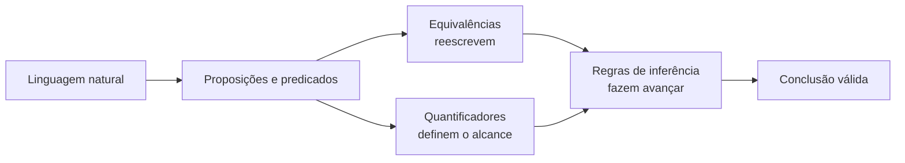

---
tags:
  - matemática-discreta
  - lógica-proposicional
  - lógica-de-predicados
  - revisão
---

# 🧭 Mapa de convergência — Lógica e Predicados

> [!abstract] Ideia central
> Os materiais convergem para uma mesma jornada: **traduzir uma afirmação**, **reescrevê-la sem alterar seu valor lógico**, **aplicar regras válidas** e **chegar a uma conclusão que realmente decorra das premissas**.

Esta nota reúne o núcleo comum entre [`Revisão_termos.pdf`](<../materiais/Revisão_termos.pdf>) e os livros/apostilas disponíveis na pasta `materiais`. O foco não é repetir cada PDF, mas conectar aquilo que reaparece entre eles e mostrar como as peças formam um único sistema.



## ⚡ O núcleo em três frases

1. **Equivalência lógica é uma troca segura:** duas fórmulas equivalentes dizem logicamente a mesma coisa e podem substituir uma à outra.
2. **Inferência é um passo justificado:** partindo de premissas, uma regra autoriza uma conclusão — sempre em uma direção específica.
3. **Quantificadores controlam “quanto” do universo está sendo afirmado:** `∀` fala de todos; `∃`, de pelo menos um. A ordem e o escopo desses símbolos importam.

---

## 1. 🔁 Equivalências: mudar a forma sem mudar a verdade

Uma equivalência `P ≡ Q` é **bidirecional**. Se um lado aparece em uma demonstração, ele pode ser substituído pelo outro sem alterar o valor lógico da expressão.

### Caixa de ferramentas comum

| Ideia | Equivalência | Leitura rápida |
| --- | --- | --- |
| De Morgan da conjunção | `¬(P ∧ Q) ≡ ¬P ∨ ¬Q` | Não ocorrerem os dois significa que ao menos um falha. |
| De Morgan da disjunção | `¬(P ∨ Q) ≡ ¬P ∧ ¬Q` | Para negar uma alternativa, negam-se todas. |
| Eliminar a implicação | `P → Q ≡ ¬P ∨ Q` | Uma implicação só é falsa quando `P` é verdadeira e `Q` é falsa. |
| Negar a implicação | `¬(P → Q) ≡ P ∧ ¬Q` | A negação descreve exatamente o contraexemplo da implicação. |
| Contraposição | `P → Q ≡ ¬Q → ¬P` | Negar a consequência permite voltar e negar a condição. |
| Abrir a bicondicional | `P ↔ Q ≡ (P → Q) ∧ (Q → P)` | “Se e somente se” exige as duas direções. |
| Outra forma da bicondicional | `P ↔ Q ≡ (P ∧ Q) ∨ (¬P ∧ ¬Q)` | As proposições têm o mesmo valor lógico. |
| Exportação | `(P ∧ Q) → R ≡ P → (Q → R)` | Duas condições conjuntas podem virar condições encadeadas. |
| Distributividade | `P ∧ (Q ∨ R) ≡ (P ∧ Q) ∨ (P ∧ R)` | A conjunção distribui sobre a disjunção. |
| Distributividade dual | `P ∨ (Q ∧ R) ≡ (P ∨ Q) ∧ (P ∨ R)` | A disjunção distribui sobre a conjunção. |
| Dupla negação | `¬¬P ≡ P` | Negar duas vezes recupera a proposição. |

> [!tip] Atalho mental para De Morgan
> A negação **entra**, nega cada parte e **troca o conectivo**: `∧ ↔ ∨`.

Essas transformações aparecem como base para tabelas-verdade, simplificação de fórmulas, demonstrações e negação de sentenças mais complexas.

---

## 2. 🧱 Regras de inferência: construir uma conclusão válida

Diferentemente das equivalências, uma regra de inferência é normalmente usada **das premissas para a conclusão**. O símbolo `⊢` pode ser lido como “permite concluir”.

| Regra | Premissas | Conclusão | Pergunta-guia |
| --- | --- | --- | --- |
| **Modus Ponens (MP)** | `P → Q`, `P` | `Q` | A condição aconteceu? Então obtenha a consequência. |
| **Modus Tollens (MT)** | `P → Q`, `¬Q` | `¬P` | A consequência falhou? Então a condição não ocorreu. |
| **Silogismo Hipotético (SH)** | `P → Q`, `Q → R` | `P → R` | As implicações formam uma corrente? |
| **Silogismo Disjuntivo (SD)** | `P ∨ Q`, `¬P` | `Q` | Uma alternativa foi eliminada? Resta a outra. |
| **Conjunção** | `P`, `Q` | `P ∧ Q` | Posso reunir dois fatos já estabelecidos? |
| **Simplificação** | `P ∧ Q` | `P` | Posso extrair uma das partes de uma conjunção? |
| **Adição** | `P` | `P ∨ Q` | Se `P` já é verdade, a disjunção também será. |

### Exemplo integrado: uma cadeia de falhas

Defina:

- `P`: o banco de dados caiu;
- `Q`: a API retornou erro 500;
- `R`: o aplicativo exibiu a tela de falha.

Premissas:

1. `P → Q`
2. `Q → R`
3. `P`

Pelo **silogismo hipotético**, das linhas 1 e 2 obtemos `P → R`. Pelo **Modus Ponens**, usando `P → R` e a linha 3, concluímos `R`.

> [!warning] Duas armadilhas clássicas
> De `P → Q` e `Q`, **não** se conclui `P` — isso seria afirmar o consequente. De `P → Q` e `¬P`, **não** se conclui `¬Q` — isso seria negar o antecedente.

---

## 3. 🌐 Predicados e quantificadores: do geral ao particular

Na lógica de predicados, `P(x)` afirma uma propriedade sobre um elemento do domínio.

- `∀x P(x)`: todo elemento possui a propriedade `P`;
- `∃x P(x)`: existe ao menos um elemento com a propriedade `P`.

As quatro transições fundamentais são:

| Movimento | Esquema | Condição essencial |
| --- | --- | --- |
| **Instanciação universal (UI)** | `∀x P(x) ⊢ P(c)` | `c` pode ser qualquer elemento do domínio. |
| **Generalização universal (UG)** | `P(c) ⊢ ∀x P(x)` | `c` deve ser arbitrário, sem hipótese especial sobre ele. |
| **Instanciação existencial (EI)** | `∃x P(x)` → use temporariamente `P(c)` | `c` deve ser um nome novo; o raciocínio não pode depender de qual testemunha ele representa. |
| **Generalização existencial (EG)** | `P(c) ⊢ ∃x P(x)` | Um caso conhecido basta para provar que existe ao menos um. |

> [!important] Cuidado com a instanciação existencial
> A escrita abreviada `∃x P(x) ⊢ P(c)` só é segura com a restrição de que `c` seja **novo** e usado de forma controlada dentro da demonstração. A premissa garante alguma testemunha, mas não permite escolher uma pessoa ou objeto já conhecido sem justificativa.

### Uma forma de não confundir

- O universal permite **descer** do todo para qualquer caso.
- O existencial permite escolher **uma testemunha nova**, sem fingir que sabemos quem ela é.
- Para **subir** ao universal, o caso precisa ser completamente genérico.
- Para **subir** ao existencial, um único caso comprovado já basta.

---

## 4. 🔄 Negação, distribuição e ordem dos quantificadores

### De Morgan para predicados

```text
¬(∀x P(x)) ≡ ∃x ¬P(x)
¬(∃x P(x)) ≡ ∀x ¬P(x)
```

Em português:

- “Nem todo mundo passou” equivale a “alguém não passou”.
- “Ninguém passou” equivale a “todos não passaram”.

Com uma condicional quantificada:

```text
¬(∀x (P(x) → Q(x))) ≡ ∃x (P(x) ∧ ¬Q(x))
```

Ou seja: para negar que toda ocorrência de `P` leva a `Q`, basta encontrar **um contraexemplo** que satisfaça `P` e não satisfaça `Q`.

### Distribuições válidas — e as que enganam

```text
∀x (P(x) ∧ Q(x)) ≡ (∀x P(x)) ∧ (∀x Q(x))       ✅
∃x (P(x) ∨ Q(x)) ≡ (∃x P(x)) ∨ (∃x Q(x))       ✅

∀x (P(x) ∨ Q(x)) ≢ (∀x P(x)) ∨ (∀x Q(x))       ❌ em geral
∃x (P(x) ∧ Q(x)) ≢ (∃x P(x)) ∧ (∃x Q(x))       ❌ em geral
```

O erro da última linha é fácil de visualizar: uma pessoa pode satisfazer `P` e outra pessoa satisfazer `Q`; isso não prova que exista uma mesma pessoa satisfazendo ambas.

### A ordem pode trocar o significado

Quantificadores do mesmo tipo podem trocar de posição:

```text
∀x∀y P(x,y) ≡ ∀y∀x P(x,y)
∃x∃y P(x,y) ≡ ∃y∃x P(x,y)
```

Quantificadores mistos, em geral, não:

```text
∃x∀y P(x,y) → ∀y∃x P(x,y)       ✅
∀y∃x P(x,y) → ∃x∀y P(x,y)       ❌ em geral
```

Pense na diferença entre “existe **uma senha** que abre todas as portas” e “para cada porta, existe **alguma senha** que a abre”.

---

## 5. 🧩 As premissas realmente compartilhadas pelos materiais

Apesar de variarem em profundidade e notação, os materiais que tratam de lógica sustentam estas ideias em comum:

1. **A validade depende da forma do argumento, não do assunto.** Semáforos, números, servidores e pessoas podem ocupar o lugar de `P`, `Q` e `R`; a estrutura lógica continua a mesma.
2. **Linguagem natural precisa ser formalizada com cuidado.** Expressões como “se”, “somente se”, “todo”, “algum” e “nenhum” determinam conectivos e quantificadores diferentes.
3. **Equivalência e inferência têm funções distintas.** A primeira transforma uma expressão; a segunda produz uma consequência a partir de premissas.
4. **Uma demonstração é uma trilha auditável.** Cada linha deve vir de uma premissa, equivalência ou regra já autorizada.
5. **Negar uma afirmação é descrever quando ela falha.** Isso explica tanto `¬(P → Q) ≡ P ∧ ¬Q` quanto a troca `∀ ↔ ∃` na negação de quantificadores.
6. **Restrições de escopo evitam conclusões indevidas.** Constantes arbitrárias, testemunhas novas e a ordem dos quantificadores não são detalhes de notação: elas alteram o que pode ser provado.

---

## 6. 📚 Mapa de cobertura dos PDFs

Legenda: **●** trata diretamente; **◐** trata parcialmente ou com outra nomenclatura; **—** não é foco do material.

| Material | Equivalências proposicionais | Regras de inferência | Predicados e quantificadores | Negações/ordem de quantificadores |
| --- | :---: | :---: | :---: | :---: |
| **Fundamentos matemáticos para a ciência da computação — Gersting** | ● | ● | ● | ● |
| **Elementos de Matemática Discreta para Computação — Gomide e Stolfi** | ● | ● | ● | ● |
| **Matemática Discreta: Combinatória, Teoria dos Grafos e Algoritmos — Cardoso, Szymański e Rostami** | ● | ◐ | ◐ | ◐ |
| **Matemática Discreta — Cabral (UAB/UECE)** | — | — | — | — |
| **Prova Comentada** | ● | ● | ● | ● |

> [!note] Sobre a apostila da UAB/UECE
> Ela compartilha o campo geral da Matemática Discreta, mas não este recorte de lógica. Seu sumário se concentra em conjuntos, relações e funções, combinatória, teoria dos números e estruturas algébricas. Por isso, ela não foi usada para afirmar convergência nos tópicos acima.

### Onde o conteúdo aparece com mais força

- **Gersting:** capítulo 1 e apêndice A — lógica formal, regras de dedução e as quatro regras para quantificadores.
- **Gomide e Stolfi:** capítulos 3 e 4 — equivalências, lógica de predicados, quantificadores e métodos de demonstração.
- **Cardoso, Szymański e Rostami:** capítulos 1 e 2 — linguagem proposicional, quantificadores, contraposição e estratégias de demonstração.
- **Prova Comentada:** aplicação em tradução, tabelas-verdade, De Morgan, Modus Tollens, formalização e negação de proposições quantificadas.

---

## 7. 🧠 Rota de resolução para exercícios

Ao receber um argumento ou uma fórmula, siga este percurso:

1. **Defina o domínio** e traduza as frases para símbolos.
2. **Marque o objetivo:** o que precisa ser concluído ou demonstrado?
3. **Procure gatilhos:** `P → Q` com `P` sugere MP; `P → Q` com `¬Q` sugere MT.
4. **Reescreva quando necessário:** elimine implicações, aplique De Morgan ou abra bicondicionais.
5. **Controle os quantificadores:** confira escopo, ordem e as restrições da constante usada.
6. **Justifique cada linha** e tente construir um contraexemplo se suspeitar que a conclusão é inválida.

> [!success] Teste final
> Pergunte: **é possível manter todas as premissas verdadeiras e tornar a conclusão falsa?** Se sim, o argumento é inválido. Se não, sua forma é válida.

---

## 🎴 Flashcards-relâmpago

**Qual é a diferença entre `≡` e `⊢`?**  
`≡` indica equivalência bidirecional; `⊢` indica que uma conclusão pode ser derivada de premissas.

**Como negar `P → Q`?**  
Afirme o único caso que a torna falsa: `P ∧ ¬Q`.

**Como negar “todos têm P”?**  
“Existe alguém que não tem P”: `∃x ¬P(x)`.

**Quando a generalização universal é permitida?**  
Quando o elemento escolhido é arbitrário e nenhuma hipótese especial sobre ele foi usada.

**Por que `∀x∃y` não é igual a `∃y∀x`?**  
Porque uma testemunha diferente pode servir para cada `x`; isso não garante uma única testemunha para todos.

---

## Fontes locais consultadas

- [`Revisão_termos.pdf`](<../materiais/Revisão_termos.pdf>) — arquivo-base.
- [`Prova_Comentada.pdf`](<../materiais/Prova_Comentada.pdf>) — exemplos resolvidos e aplicação prática (cópia também em `../provas/`).
- [`Fundamentos matemáticos para a ciência da computação — Gersting`](../materiais/Fundamentos%20matem%C3%A1ticos%20para%20a%20ci%C3%AAncia%20da%20computa%C3%A7%C3%A3o%20Matem%C3%A1tica%20Discreta%20e%20Suas%20Aplica%C3%A7%C3%B5es%20%28Judith%20L.%20Gersting%29.pdf).
- [`Elementos de matemática discreta`](<../materiais/Elementos de matematica discreta_livro.pdf>).
- [`Matemática Discreta: Combinatória, Teoria dos Grafos e Algoritmos`](<../materiais/Livro_MD.pdf>).
- [`Matemática Discreta — UAB/UECE`](<../materiais/Livro_Matematica Discreta.pdf>).

