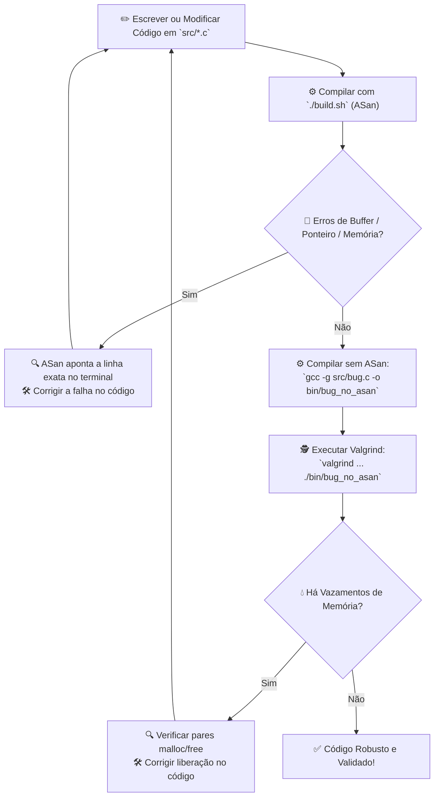

# 🛠️ Guia de Ferramentas: ASan e Valgrind (`teste 1`)

Em linguagens como **C** e **C++**, o gerenciamento manual de memória dá controle total ao programador, mas também abre espaço para falhas críticas como *buffer overflows*, acessos ilegais, uso de memória liberada (*use-after-free*) e vazamentos de memória (*memory leaks*).

Este guia documenta o uso prático de duas das ferramentas mais importantes de depuração e inspeção de memória: **AddressSanitizer (ASan)** e **Valgrind (Memcheck)**, utilizando como base a organização prática dos arquivos da pasta **`teste 1`**.

---

## 📁 1. Estrutura da Pasta `teste 1`

A organização dos arquivos no diretório segue o padrão modular para compilação e testes em C:

```text
teste 1/
├── bin/                      # Diretório de saída dos binários compilados
│   ├── bug                   # Executável compilado com AddressSanitizer (ASan)
│   └── bug_no_asan           # Executável compilado sem ASan (pronto para o Valgrind)
├── src/                      # Códigos-fonte do projeto (.c)
│   └── bug.c                 # Exemplo prático contendo falha de memória na Heap
├── build.sh                  # Script bash de automação de compilação em lote
└── guia de configuração.md   # Documentação e guia prático de execução
```

### 📋 Descrição dos Componentes

| Arquivo / Diretório | Descrição e Finalidade |
| :--- | :--- |
| **`src/`** | Diretório contendo os arquivos de código-fonte (`.c`). |
| **`src/bug.c`** | Código de teste contendo um erro proposital de acesso fora dos limites de um array alocado dinamicamente. |
| **`bin/`** | Diretório de destino dos binários executáveis gerados na compilação. |
| **`bin/bug`** | Binário compilado com a flag `-fsanitize=address` (ASan) para capturar violações de memória em tempo de execução. |
| **`bin/bug_no_asan`** | Binário compilado convencionalmente com `-g` (sem ASan) para permitir inspeção através do **Valgrind**. |
| **`build.sh`** | Script de automação que varre a pasta `src/` e compila todos os códigos `.c` para a pasta `bin/` usando ASan. |
| **`guia de configuração.md`** | Este guia completo de instruções, diagnósticos e melhores práticas. |

---

## 🧪 2. Estudo de Caso Prático: `src/bug.c`

O código presente em `src/bug.c` ilustra um erro clássico de **estouro de buffer na Heap** (*Heap Buffer Overflow* / *Off-by-one*):

```c
#include <stdio.h>
#include <stdlib.h>

int main() {
    // Aloca espaço na Heap para 5 inteiros (índices válidos: 0, 1, 2, 3 e 4)
    int *vetor = malloc(5 * sizeof(int));

    // ERRO: O índice [5] é o 6º elemento, fora da região de memória alocada!
    vetor[5] = 100;
    printf("Valor: %d\n", vetor[5]);

    free(vetor);
    return 0;
}
```

> [!WARNING] O perigo do Comportamento Indefinido (*Undefined Behavior*)
> Sem ferramentas de sanitização, esse código muitas vezes compila e roda normalmente sem emitir alertas visíveis (ou corrompendo silenciosamente áreas adjacentes da memória). ASan e Valgrind garantem a captura imediata e precisa desse erro.

---

## 🚀 3. Automação de Compilação com `build.sh`

Para agilizar o desenvolvimento e evitar a digitação manual de comandos longos do compilador, a pasta conta com o script de automação `build.sh`.

### 📜 Código do Script (`build.sh`)

```bash
#!/bin/bash

# Garante que o diretório de saída existe
mkdir -p bin

# Varre todos os arquivos .c dentro da pasta src
for file in src/*.c; do
    # Garante que o arquivo existe antes de compilar
    [ -e "$file" ] || continue

    # Obtém o nome base sem caminho e sem extensão
    filename=$(basename "$file" .c)

    # Compila com símbolos de debug (-g) e AddressSanitizer (-fsanitize=address)
    gcc -g -fsanitize=address "$file" -o "bin/$filename"

    echo "✅ Compilado com sucesso: bin/$filename"
done
```

### 🔑 Permissão de Execução e Uso

1. **Conceder permissão de execução** (necessário apenas uma vez):
   ```bash
   chmod +x build.sh
   ```

2. **Executar a compilação em lote**:
   ```bash
   ./build.sh
   ```

3. **Resultado**: O executável instrumentado com ASan será gerado em `bin/bug`.

---

## ⚡ 4. AddressSanitizer (ASan)

O **AddressSanitizer** é um detector de erros de memória ultrarrápido desenvolvido pela Google e integrado nativamente ao **GCC** e **Clang**. Ele adiciona verificações de segurança no próprio binário (*instrumentação em tempo de compilação*).

### ⚙️ Compilação Manual com ASan

Caso queira compilar manualmente um arquivo específico sem usar o `build.sh`:

```bash
gcc -g -fsanitize=address src/bug.c -o bin/bug
```

- `-g`: Adiciona símbolos de depuração (permite exibir nomes de funções e linhas exatas no código-fonte).
- `-fsanitize=address`: Habilita o AddressSanitizer.

### ▶️ Como Executar

Basta rodar o binário gerado na pasta `bin/`:

```bash
./bin/bug
```

### 📋 Diagnóstico Retornado pelo ASan

Ao executar o `./bin/bug`, o ASan intercepta o acesso ilegal de memória no exato instante em que ele ocorre, abortando o programa com um relatório detalhado:

```console
=================================================================
==13281==ERROR: AddressSanitizer: heap-buffer-overflow on address 0x503000000054 at pc 0x58894f7d82a2 bp 0x7fffa5564340 sp 0x7fffa5564330
WRITE of size 4 at 0x503000000054 thread T0
    #0 0x58894f7d82a1 in main src/bug.c:7
    ...

0x503000000054 is located 0 bytes after 20-byte region [0x503000000040,0x503000000054)
allocated by thread T0 here:
    #0 0x771161efd9c7 in malloc ../../../../src/libsanitizer/asan/asan_malloc_linux.cpp:69
    #1 0x58894f7d825e in main src/bug.c:5
=================================================================
```

> [!TIP] Como Interpretar o Relatório do ASan
> 1. **Tipo de Erro**: `heap-buffer-overflow` (acesso fora dos limites da Heap).
> 2. **Operação Inválida**: `WRITE of size 4` (tentativa de escrita de 4 bytes = tamanho de um `int`).
> 3. **Linha da Falha**: `src/bug.c:7` (`vetor[5] = 100;`).
> 4. **Origem da Alocação**: `src/bug.c:5` (bloco de 20 bytes alocado por `malloc(5 * sizeof(int))`).

---

## 🕵️ 5. Valgrind (Memcheck)

O **Valgrind** é uma ferramenta de análise dinâmica que executa o código dentro de uma máquina virtual emulada, inspecionando cada instrução de acesso à memória.

> [!IMPORTANT]
> **Atenção: Não execute o Valgrind em binários compilados com `-fsanitize=address`!**
> O ASan e o Valgrind possuem mecanismos de controle de memória próprios que entram em conflito. Para usar o Valgrind, compile o binário sem ASan (`bin/bug_no_asan`).

### ⚙️ Como Compilar para o Valgrind (Sem ASan)

Compile apenas com símbolos de depuração (`-g`):

```bash
gcc -g src/bug.c -o bin/bug_no_asan
```

### ▶️ Como Executar com Valgrind

Execute o binário `bin/bug_no_asan` através do utilitário `valgrind`:

```bash
valgrind --leak-check=full --show-leak-kinds=all --track-origins=yes ./bin/bug_no_asan
```

### 📋 Diagnóstico Retornado pelo Valgrind

```console
==13331== Memcheck, a memory error detector
==13331== Command: ./bin/bug_no_asan
==13331== 
==13331== Invalid write of size 4
==13331==    at 0x40011AB: main (bug.c:7)
==13331==  Address 0x4a8d054 is 0 bytes after a block of size 20 alloc'd
==13331==    at 0x484B80F: malloc (vg_replace_malloc.c:447)
==13331==    by 0x400119E: main (bug.c:5)
==13331== 
==13331== Invalid read of size 4
==13331==    at 0x40011B9: main (bug.c:8)
==13331==  Address 0x4a8d054 is 0 bytes after a block of size 20 alloc'd
==13331==    at 0x484B80F: malloc (vg_replace_malloc.c:447)
==13331==    by 0x400119E: main (bug.c:5)
==13331== 
==13331== HEAP SUMMARY:
==13331==     in use at exit: 0 bytes in 0 blocks
==13331==   total heap usage: 2 allocs, 2 frees, 1,044 bytes allocated
==13331== 
==13331== All heap blocks were freed -- no leaks are possible
==13331== ERROR SUMMARY: 2 errors from 2 contexts
```

> [!TIP] Principais Flags do Valgrind
> - `--leak-check=full`: Exibe detalhes completos de cada bloco de memória vazado.
> - `--show-leak-kinds=all`: Mostra todos os tipos de vazamentos (`definite`, `indirect`, `possible`, `reachable`).
> - `--track-origins=yes`: Rastreia a origem exata de valores de memória não inicializados.

---

## 🔄 6. Comparativo: ASan vs. Valgrind

| Recurso | AddressSanitizer (ASan) | Valgrind (Memcheck) |
| :--- | :--- | :--- |
| **Binário utilizado em `teste 1`** | `bin/bug` | `bin/bug_no_asan` |
| **Abordagem** | Instrumentação em compilação | Emulação dinâmica de binário |
| **Impacto de Desempenho** | Muito baixo (~2x mais lento) | Alto (~10x a 30x mais lento) |
| **Uso de Memória Adicional** | Moderado (~2x a 3x) | Alto |
| **Erros na Stack e Globais** | ✅ Detecta nativamente | ❌ Limitado |
| **Uso de Variável Não Inicializada** | ⚠️ Requer `-fsanitize=memory` (MSan) | ✅ Detecta nativamente |
| **Vazamento de Memória (*Leaks*)** | ✅ Integrado com LSan (`-fsanitize=leak`) | ✅ Excelente análise detalhada |
| **Cenário de Uso Recomendado** | Desenvolvimento diário, testes unitários, CI/CD | Análise profunda e verificação de vazamentos |

---

## 📊 7. Fluxo de Depuração Recomendado



---

## 💡 8. Resumo Rápido de Comandos

```bash
# ========================================================
# 1. Compilar tudo automaticamente com ASan via script
# ========================================================
./build.sh

# ========================================================
# 2. Executar binário com ASan
# ========================================================
./bin/bug

# ========================================================
# 3. Compilar manualmente para análise com Valgrind (sem ASan)
# ========================================================
gcc -g src/bug.c -o bin/bug_no_asan

# ========================================================
# 4. Rodar o Valgrind completo no binário sem ASan
# ========================================================
valgrind --leak-check=full --track-origins=yes ./bin/bug_no_asan
```