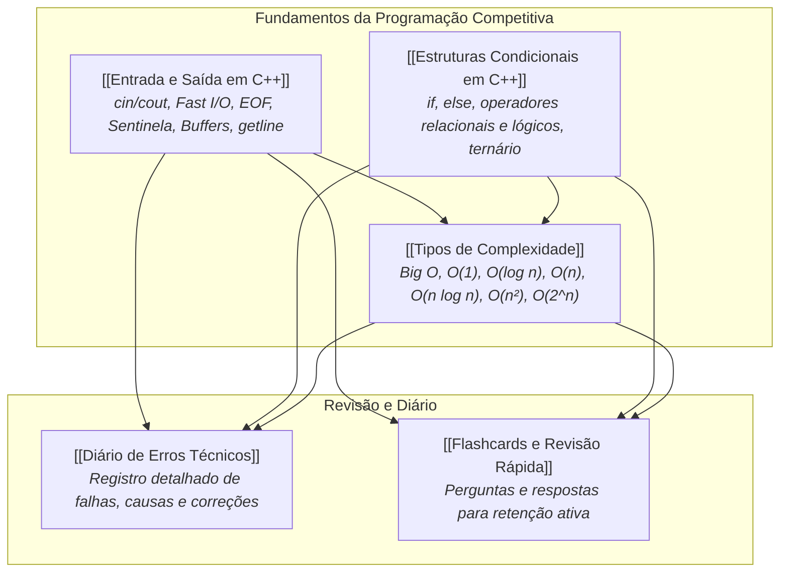

# 🏆 Maratona SBC — Base de Conhecimento FACOMpetindo

> **Notas de Estudo Pessoais para Programação Competitiva e Maratona SBC**  
> *Base estruturada a partir do material FACOMpetindo Pessoal.*

---

## 🗺️ Mapa de Conhecimento e Relações

---

## 📑 Notas Principais

1. **[[Entrada e Saída em C++]]**:
   - `cin`, `cout`, `cerr`, `endl` vs `'\n'`.
   - Conceito de **Buffer** e **Flush**.
   - Formatos de leitura: Quantidade determinada, Valor sentinela e Leitura até `EOF`.
   - Leitura de linhas inteiras com `getline` e limpeza de buffer com `cin.ignore()`.
   - **Fast I/O**: `ios::sync_with_stdio(false);` e `cin.tie(nullptr);`.
   - Checklist prático para problemas da SBC.

2. **[[Tipos de Complexidade]]**:
   - Notação **Big O** e comportamento assintótico.
   - Análise detalhada por classe:
     - `O(1)` — Tempo constante (acesso a vetores, cuidado com retorno precoce).
     - `O(n)` — Tempo linear (percorrer vetores, fatorial iterativo).
     - `O(log n)` — Tempo logarítmico (busca binária em dados ordenados).
     - `O(n log n)` — Tempo linearítmico (Merge Sort, algoritmos eficientes de ordenação).
     - `O(n²)` — Tempo quadrático (pares aninhados, força bruta).
     - `O(2^n)` — Tempo exponencial (Fibonacci recursivo ingênuo $\phi^n \le 2^n$).
   - Regra prática para a Maratona SBC.

3. **[[Estruturas Condicionais em C++]]**:
   - `if`, `else if` e `else`.
   - Operadores relacionais (`>`, `>=`, `<`, `<=`, `==`, `!=`).
   - Operadores lógicos (`&&`, `||`, `!`) e avaliação em curto-circuito.
   - Operador ternário (`? :`) e variáveis booleanas (`bool`).
   - Armadilha clássica: atribuição `=` vs comparação `==`.

4. **[[Diário de Erros Técnicos]]**:
   - Erro do buffer residual entre `cin >>` e `getline`.
   - Erro da condição sentinela (`||` em vez de `&&`).
   - Erro de lentidão por uso de `endl` em laços grandes.
   - Erro de confundir existência de `for` com `O(n)` automático.
   - Erro de atribuição `=` dentro da condição do `if`.

5. **[[Flashcards e Revisão Rápida]]**:
   - Cartões de fixação no formato `Q:` (Pergunta) / `A:` (Resposta) cobrindo todos os tópicos fundamentais.

---

## 🎯 Checklist para a SBC (Guia Rápido de Contest)

Antes de implementar qualquer solução, execute este checklist:

- [ ] **Formato de Encerramento:** A quantidade é informada? Há sentinela (ex.: `0 0`)? Ou termina em `EOF` (`while(cin >> x)`)?
- [ ] **Tipo de Leitura:** São tokens separados por espaço (`cin >>`) ou linhas completas com espaços (`getline`)?
- [ ] **Limpeza de Buffer:** Se usou `getline` após `cin >>`, colocou `cin.ignore()`?
- [ ] **Volume de Dados:** A quantidade de operações justifica **Fast I/O**?
- [ ] **Quebras de Linha:** Usou `'\n'` em vez de `endl`?
- [ ] **Análise de $N$:** Qual o valor máximo de $N$? A complexidade escolhida cabe no tempo de 1 segundo ($10^8$ operações)?
