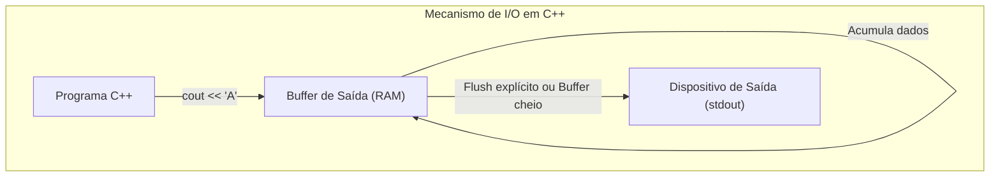
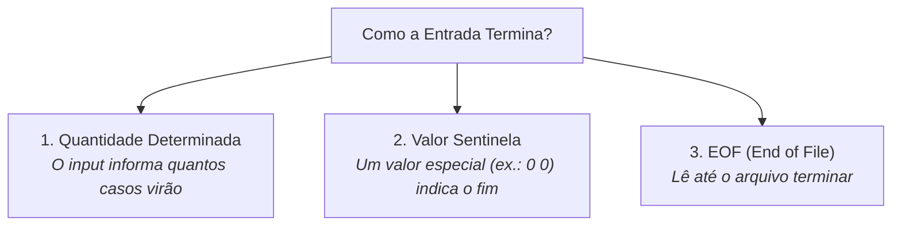

# Entrada e Saída em C++

## Conceito

Em programação competitiva, a entrada e a saída de dados são fundamentais. Os problemas normalmente fornecem os dados por meio da **entrada padrão (`stdin`)** e esperam que a resposta seja enviada pela **saída padrão (`stdout`)**.

Em C++, as principais ferramentas para isso pertencem à biblioteca `<iostream>`:

- `cin` → entrada de dados (lê tokens separados por espaço, tabulação ou quebra de linha);
- `cout` → saída de dados;
- `cerr` → saída de mensagens de erro (não bufferizada);
- `endl` → quebra de linha (`'\n'`) + descarga imediata do buffer (`flush`).

Para a grande maioria dos problemas da Maratona SBC, `cin` e `cout` são suficientes e eficientes, desde que configurados adequadamente.

---

## Como funciona

### 1. Leitura por Tokens (`cin >>`)
O operador `>>` lê valores ignorando espaços em branco, quebras de linha e tabulações antes do próximo valor. Ele não depende de linhas inteiras; ele consome **tokens**:

```text
Entrada 1:  10 20 30
Entrada 2:  10
            20
            30
```
Ambas são lidas exatamente da mesma forma com `cin >> a >> b >> c;`.

### 2. Leitura de Linhas Inteiras (`getline`)
Quando o texto de entrada contém espaços que fazem parte do dado (ex.: `"Universidade Federal do Amazonas"`), `cin >>` lê apenas `"Universidade"`. Para capturar a linha inteira, utiliza-se:

```cpp
string texto;
getline(cin, texto);
```

#### O problema de `cin` seguido de `getline`
Se executarmos `cin >> n;` e logo em seguida `getline(cin, texto);`, o `cin >> n` consome o número, mas deixa o caractere de quebra de linha `\n` pendente no buffer de entrada. O `getline` imediatamente consome esse `\n` e retorna uma string vazia.

**Solução:** Limpar o buffer antes do `getline`:
```cpp
cin >> n;
cin.ignore(numeric_limits<streamsize>::max(), '\n'); // ou simplesmente cin.ignore();
getline(cin, texto);
```

### 3. Mecanismo de Buffer e Flush



- **Buffer:** Região temporária de memória utilizada para acumular dados antes de enviá-los em bloco para o dispositivo externo, reduzindo chamadas de sistema operacional.
- **Flush:** Ação de descarregar imediatamente os dados do buffer para o destino.
- **`'\n'` vs `endl`:**
  - `'\n'`: Apenas insere o caractere de quebra de linha no buffer.
  - `endl`: Insere `'\n'` **e executa um `flush`**.
  - Em laços com $10^5$ ou $10^6$ iterações, `endl` força milhares de descargas desnecessárias, causando **Time Limit Exceeded (TLE)**.

### 4. Fast I/O: Desempenho em Larga Escala
```cpp
ios::sync_with_stdio(false);
cin.tie(nullptr);
```
- `ios::sync_with_stdio(false);`: Desativa a sincronização entre os streams do C++ (`cin`/`cout`) e os streams do C (`scanf`/`printf`), permitindo que o C++ gerencie seus buffers de forma independente e muito mais rápida.
- `cin.tie(nullptr);`: Remove o vínculo que força um `flush` automático no `cout` antes de cada operação no `cin`.

---

## Exemplo

### Os 3 Formatos Principais de Entrada na SBC



#### 1. Quantidade Determinada
```cpp
int n;
cin >> n;
vector<int> vet(n);
for (int i = 0; i < n; i++) {
    cin >> vet[i];
}
```

#### 2. Valor Sentinela (Exemplo: termina quando ambos forem `0 0`)
```cpp
int atacantes, defensores;
while (cin >> atacantes >> defensores) {
    if (atacantes == 0 && defensores == 0) {
        break; // Encerra somente quando ambos forem 0
    }
    // Processamento do caso
}
```

#### 3. Fim de Arquivo (EOF — *End of File*)
```cpp
int x;
while (cin >> x) {
    // Continua executando enquanto for possível realizar a leitura com sucesso
    // Ao atingir o EOF, cin entra em estado de falha e o laço termina
}
```

---

## Código

### Template Padrão de Competição
```cpp
#include <bits/stdc++.h>

using namespace std;

int main() {
    // Otimização de Entrada e Saída
    ios::sync_with_stdio(false);
    cin.tie(nullptr);

    int n;
    while (cin >> n) {
        vector<int> vet(n);
        for (int i = 0; i < n; i++) {
            cin >> vet[i];
        }

        // Impressão com quebra simples de linha
        for (int i = 0; i < n; i++) {
            cout << vet[i] << (i + 1 == n ? '\n' : ' ');
        }
    }

    return 0;
}
```

---

## Complexidade

- **Tempo:**
  - Leitura/Escrita por token: $O(K)$, onde $K$ é o número de caracteres lidos/impressos.
  - Leitura por linha (`getline`): $O(L)$, onde $L$ é o tamanho da linha.
  - O Fast I/O reduz o tempo total de I/O de $O(N)$ com constantes pesadas para tempo quase instantâneo ($< 0.1\text{s}$ para $10^6$ inteiros).
- **Memória:** $O(1)$ adicional além do armazenamento dos dados lidos.

---

## Erros comuns

1. **Misturar `cin`/`cout` com `scanf`/`printf` após `ios::sync_with_stdio(false)`:**  
   Após desativar a sincronização, os streams de C e C++ deixam de coordenar seus buffers, o que resulta em saídas fora de ordem e corrupção de dados.
2. **Utilizar `endl` em laços repetitivos:**  
   Gera milhares de operações de `flush` no sistema operacional, causando Time Limit Exceeded (TLE).
3. **Confundir a condição de parada em sentinelas compostos:**  
   Se o problema termina quando ambos são zero (`0 0`), usar `if (a == 0 || b == 0)` encerra o programa incorretamente quando *qualquer um* deles for zero. A condição correta é `if (a == 0 && b == 0)`.
4. **Esquecer `cin.ignore()` antes de `getline`:**  
   Resulta na leitura de strings vazias indesejadas.

---

## Quando usar

- **Regra Geral:** Use sempre `ios::sync_with_stdio(false); cin.tie(nullptr);` e `'\n'` por padrão em todos os problemas da Maratona SBC.
- **`getline`:** Use quando a entrada contiver frases, espaços ou linhas textuais completas.
- **`flush` explícito (`cout << flush` ou `endl`):** Use **apenas** em problemas interativos, onde o juiz eletrônico precisa receber a pergunta do seu programa antes de enviar a resposta.

---

## Aplicação na programação competitiva

Problemas normais da SBC/Beecrowd possuem limites rígidos de tempo (tipicamente 1.0s). Em problemas onde o tamanho da entrada atinge $10^5$ ou $10^6$ linhas, a diferença entre usar `endl` e `'\n'` com Fast I/O é a diferença direta entre receber **TLE** ou **Accepted**.

---

## Erro que cometi

### Uso de condição `||` em vez de `&&` para sentinela `0 0`
- **O que eu fiz:** Em um problema com múltiplos casos de teste finalizados por `0 0`, escrevi `if (atacantes == 0 || defensores == 0) break;`.
- **Por que estava errado:** O programa parou prematuramente no primeiro caso de teste válido em que apenas um dos times não tinha jogadores (`atacantes == 0` e `defensores == 5`), deixando de processar o restante da entrada e gerando Wrong Answer (WA).
- **Como perceber:** O programa parava a execução antes de processar todos os casos do exemplo.
- **Como corrigir:** Substituir por `if (atacantes == 0 && defensores == 0) break;`.
- **Como evitar novamente:** Analisar com atenção estrita a descrição textual da condição de parada no enunciado.

---

## Flashcards

Q: Para que servem `ios::sync_with_stdio(false)` e `cin.tie(nullptr)`?  
A: `sync_with_stdio(false)` desativa a sincronização com o `stdio` da linguagem C, e `cin.tie(nullptr)` desvincula `cin` de `cout`, acelerando significativamente a velocidade de entrada e saída em C++.

Q: Qual a diferença prática entre `'\n'` e `endl`?  
A: `'\n'` apenas escreve a quebra de linha no buffer, enquanto `endl` escreve a quebra e força o descarregamento imediato (`flush`) do buffer, sendo muito mais lento.

Q: Por que o padrão `while (cin >> x)` funciona para ler até o fim de arquivo (EOF)?  
A: Porque a expressão `cin >> x` retorna o próprio stream `cin`, que avalia como verdadeiro enquanto houver dados válidos e converte-se em falso quando atinge o EOF ou falha de leitura.

Q: O que acontece se utilizarmos `getline(cin, s)` logo após `cin >> n` sem chamar `cin.ignore()`?  
A: O `getline` consome o caractere de quebra de linha `\n` que ficou pendente no buffer pelo `cin >> n`, retornando uma string vazia.

---

## Relações

- [[Tipos de Complexidade]]: Otimização de tempo constante em programas de grande escala.
- [[Estruturas Condicionais em C++]]: Avaliação de condições sentinela e fluxo de laços.
- [[Diário de Erros Técnicos]]: Autópsia de erros de I/O e limites de buffer.

---

## Resumo

| Recurso | Função |
| :--- | :--- |
| `cin >> x` | Lê um valor/token ignorando espaços em branco |
| `getline(cin, s)` | Lê uma linha inteira contendo espaços |
| `cout << x` | Imprime um valor |
| `'\n'` | Insere uma quebra de linha no buffer (rápido) |
| `endl` | Insere quebra de linha + `flush` do buffer (lento) |
| `flush` | Descarrega imediatamente o buffer de saída |
| `ios::sync_with_stdio(false)` | Desativa sincronização entre streams C e C++ |
| `cin.tie(nullptr)` | Remove a amarração entre `cin` e `cout` |
| `while (cin >> x)` | Lê dados continuamente até atingir o fim do arquivo (EOF) |
