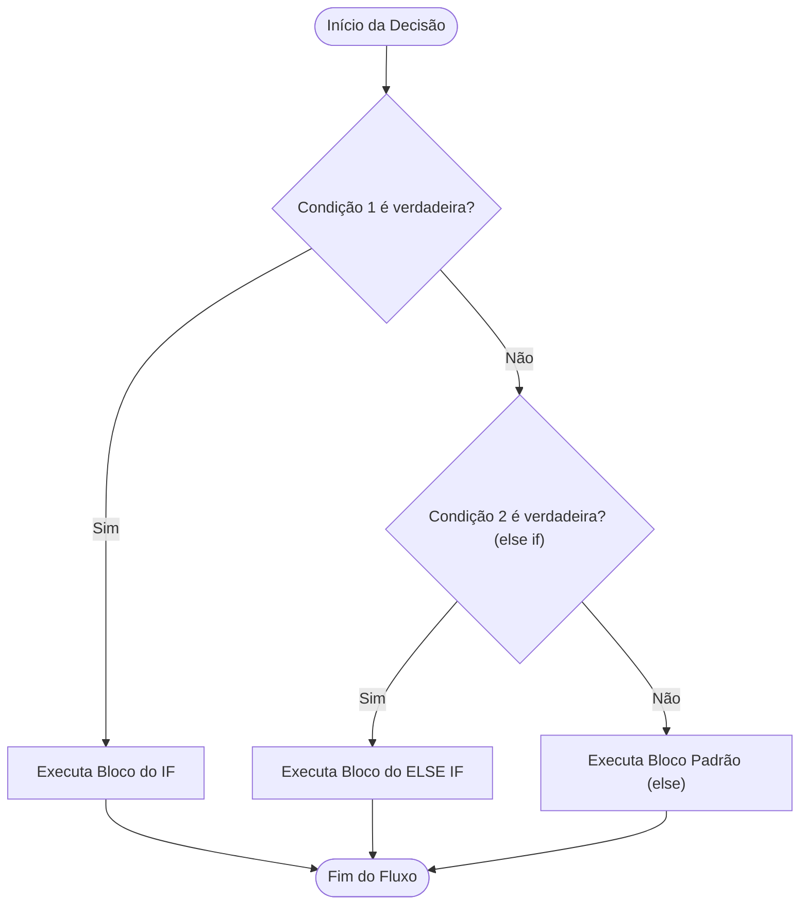

# Estruturas Condicionais em C++

## Conceito

As **estruturas condicionais** permitem que um programa tome decisões diferentes e execute blocos de instruções distintos dependendo dos valores recebidos na entrada.

Em C++, as principais ferramentas condicionais são:
- `if` ("se"): Executa um bloco caso a condição entre parênteses seja verdadeira;
- `else if` ("senão se"): Avalia uma condição alternativa caso as anteriores tenham sido falsas;
- `else` ("senão"): Executa um bloco padrão quando nenhuma das condições anteriores for satisfeita;
- Operador Ternário (`? :`): Estrutura concisa para seleção entre dois valores em uma única expressão;
- Variáveis `bool`: Tipo de dado lógico que armazena estritamente `true` (verdadeiro) ou `false` (falso).

---

## Como funciona

### 1. Fluxo Sequencial de Avaliação



As condições são avaliadas de cima para baixo. Assim que uma condição resulta em `true`, seu respectivo bloco executa e todas as demais ramificações encadeadas são ignoradas.

---

### 2. Operadores Relacionais
Utilizados para comparar valores numéricos ou variáveis:

| Operador | Significado | Exemplo ($x=10$) | Resultado |
| :---: | :--- | :---: | :---: |
| `>` | Maior que | `x > 5` | `true` |
| `>=` | Maior ou igual | `x >= 10` | `true` |
| `<` | Menor que | `x < 20` | `true` |
| `<=` | Menor ou igual | `x <= 9` | `false` |
| `==` | Igual a | `x == 10` | `true` |
| `!=` | Diferente de | `x != 10` | `false` |

> [!WARNING]
> **Atenção: `=` vs `==`**  
> - `x = 5;` significa **atribuir** o valor `5` à variável `x`.  
> - `x == 5` significa **verificar se** `x` é igual a `5`.  
> Escrever `if (x = 5)` dentro de uma condição atribui `5` a `x` e avalia como `true` incondicionalmente, gerando um erro sutil e grave.

---

### 3. Operadores Lógicos e Avaliação em Curto-Circuito

| Operador | Significado | Descrição |
| :---: | :--- | :--- |
| `&&` | **E** (Conjunção) | Verdadeiro apenas se **ambas** as condições forem verdadeiras |
| `\|\|` | **OU** (Disjunção) | Verdadeiro se **pelo menos uma** das condições for verdadeira |
| `!` | **NÃO** (Negação) | Inverte o valor lógico (`!true == false`, `!false == true`) |

#### Avaliação em Curto-Circuito (*Short-Circuit Evaluation*)
Em C++, os operadores `&&` e `||` interrompem a avaliação assim que o resultado final for conhecido:
- No `A && B`: se `A` for falso, `B` **não é executado**.
- No `A || B`: se `A` for verdadeiro, `B` **não é executado**.

Isso é fundamental para proteger acessos a ponteiros ou posições de vetores:
```cpp
if (i < static_cast<int>(vet.size()) && vet[i] == 10) {
    // Se i >= vet.size(), a segunda condição nem sequer é avaliada, evitando Segmentation Fault!
}
```

---

### 4. Operador Ternário
Permite escolher entre dois valores em uma linha:
```cpp
condicao ? valor_se_verdadeiro : valor_se_falso;
```
Exemplo:
```cpp
int x = 10;
string resposta = (x > 0) ? "positivo" : "nao positivo";
```

---

## Exemplo

### 1. Verificação de Maioridade (Baseado no `teste1.cpp`)
```cpp
#include <iostream>

using namespace std;

int main() {
    int idade;
    if (cin >> idade) {
        if (idade >= 18) {
            cout << "Você é maior de idade\n";
        } else {
            cout << "Você é menor de idade\n";
        }
    }
    return 0;
}
```

### 2. Classificação de um Número Inteiro
```cpp
#include <iostream>

using namespace std;

int main() {
    int n;
    if (cin >> n) {
        if (n > 0) {
            cout << "positivo\n";
        } else if (n < 0) {
            cout << "negativo\n";
        } else {
            cout << "zero\n";
        }
    }
    return 0;
}
```

---

## Código

### Uso de Variáveis Booleanas e Expressões Encadeadas
```cpp
#include <iostream>

using namespace std;

int main() {
    int nota = 8;
    int recuperacao = 0;

    // Atribuição direta de resultado lógico a uma variável bool
    bool aprovado_direto = (nota >= 7);
    bool fez_recuperacao = (recuperacao == 1);

    if (aprovado_direto || (nota >= 5 && fez_recuperacao)) {
        cout << "Aprovado\n";
    } else {
        cout << "Reprovado\n";
    }

    // Saída binária rápida com ternário
    cout << (aprovado_direto ? "Status: Excelente\n" : "Status: Regular\n");

    return 0;
}
```

---

## Complexidade

- **Tempo:** `O(1)` por avaliação condicional elementar.
- **Espaço:** `O(1)` adicional.

---

## Erros comuns

1. **Confundir atribuição `=` com comparação `==`:** Escrever `if (x = 0)` força `x` a `0` e o `if` avalia como falso.
2. **Omitir chaves `{}` em blocos com mais de uma linha:**  
   ```cpp
   if (x > 0)
       cout << "Positivo\n";
       x++; // Esta linha executa SEMPRE, pois está fora do if!
   ```
   **Boa prática:** Utilize sempre chaves `{}` para delimitar blocos, tornando o código claro e seguro.
3. **Erros de digitação em strings de saída:** Como imprimir `\nc` em vez de `\n`, gerando **Wrong Answer (WA)** no juiz automático.

---

## Quando usar

- **`if / else if / else`:** Para lógica estruturada com múltiplos ramos ou decisões com efeitos colaterais.
- **Operador Ternário (`? :`):** Para escolhas pontuais e atribuições simples de variáveis ou saídas `cout << (ok ? "SIM\n" : "NAO\n")`.
- **Variáveis `bool`:** Para salvar flags de estado calculadas em um ponto do programa e reutilizadas posteriormente.

---

## Aplicação na programação competitiva

A modelagem correta de condicionais é o primeiro passo para traduzir as regras do problema em código executável. Antes de programar, identifique todas as possibilidades possíveis (casos normais e casos extremos / *corner cases*) e estruture as condições em ordem clara.

---

## Erro que cometi

### Caractere extra na quebra de linha da string de saída
- **O que eu fiz:** No arquivo `teste1.cpp`, escrevi `cout << "Você é menor de idade\nc";` dentro do bloco `else`.
- **Por que estava errado:** O caractere `'c'` após `\n` foi enviado para a saída padrão (`stdout`), fazendo com que o juiz automático rejeitasse a submissão com Wrong Answer (100% de erro de apresentação/conteúdo).
- **Como perceber:** Ao comparar a saída do programa com o exemplo do enunciado, aparecia uma letra `'c'` solta no final da linha.
- **Como corrigir:** Remover o caractere excedente: `cout << "Você é menor de idade\n";`.
- **Como evitar novamente:** Revisar minuciosamente as strings literais de saída antes de submeter.

---

## Flashcards

Q: Qual a diferença entre `=` e `==` em C++?  
A: `=` é o operador de atribuição (guarda um valor na variável), enquanto `==` é o operador de comparação de igualdade (retorna `true` se os valores forem iguais).

Q: Como funciona o operador lógico `&&` (E)?  
A: Retorna `true` se e somente se ambas as condições conectadas forem verdadeiras.

Q: O que é a avaliação em curto-circuito em C++?  
A: É a regra pela qual a avaliação de uma expressão com `&&` ou `||` é interrompida assim que o resultado já puder ser determinado pela primeira condição.

Q: Qual a sintaxe do operador ternário em C++?  
A: `condicao ? valor_se_verdadeiro : valor_se_falso;`

---

## Relações

- [[Entrada e Saída em C++]]: Leitura de dados que alimentam as tomadas de decisão.
- [[Tipos de Complexidade]]: Análise de pior caso em fluxos condicionais.
- [[Diário de Erros Técnicos]]: Prevenção de falhas com `=` vs `==` e formatação de saída.

---

## Resumo

1. Use `if`, `else if` e `else` para controle de fluxo baseado em condições.
2. Nunca confunda `=` (atribuição) com `==` (comparação).
3. Use `&&` para conjunção, `||` para disjunção e `!` para negação.
4. Aproveite o operador ternário `? :` para simplificar atribuições diretas.
5. Use sempre chaves `{}` para delimitar blocos com clareza.
