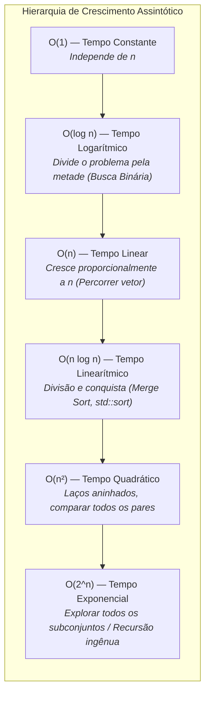

# Tipos de Complexidade

## Conceito

A análise de complexidade permite estimar como o custo de um algoritmo cresce conforme o tamanho da entrada $n$ aumenta.

Na programação competitiva, normalmente utilizamos a **Notação Big O** ($O$) para descrever a ordem de crescimento do tempo de execução de um algoritmo no pior caso.

> **Observação:** O Big O descreve principalmente o comportamento **assintótico** do algoritmo. Constantes multiplicativas e termos de menor ordem normalmente são desconsiderados.

![[assets/complexity_big(o).png]]
![[assets/Níveis de complexidade.png]]

---

## Como funciona

Abaixo estão as principais classes de complexidade que aparecem nos problemas da Maratona SBC, ordenadas da mais eficiente para a menos eficiente:

```text
O(1)  <  O(log n)  <  O(n)  <  O(n log n)  <  O(n²)  <  O(2^n)
```

Quanto mais rapidamente uma complexidade cresce, menor tende a ser o tamanho máximo de entrada $n$ que o algoritmo consegue processar dentro do limite de tempo de 1 segundo.



---

## Detalhamento das Classes de Complexidade

---

### 1. O(1) — Tempo Constante

#### Ideia
Um algoritmo possui complexidade `O(1)` quando a quantidade de operações realizadas **não depende do tamanho da entrada `n`**. Mesmo que `n` aumente para 1 bilhão, o algoritmo realiza aproximadamente a mesma quantidade de trabalho.

#### Quando usar
Aparece frequentemente em:
- Acessar uma posição de um vetor (`array[0]`, `vet[i]`);
- Consultar ou alterar o valor de uma variável;
- Realizar operações aritméticas simples;
- Operações de topo em pilhas e filas (`st.top()`, `q.front()`).

#### Código
```cpp
#include <iostream>
#include <vector>

int firstElement(const std::vector<int>& array) {
    return array[0];
}

int main() {
    std::vector<int> score = {12, 55, 67, 94, 22};
    std::cout << firstElement(score) << '\n'; // 12
    return 0;
}
```

#### Complexidade
- **Tempo:** `O(1)`
- **Espaço adicional:** `O(1)`

#### Erro Comum
Concluir precipitadamente que **todo laço `for` possui complexidade `O(n)`**. Considere:
```cpp
int firstElement(const std::vector<int>& array) {
    for (int i = 0; i < static_cast<int>(array.size()); i++) {
        return array[0]; // Retorna imediatamente na primeira iteração!
    }
    return -1;
}
```
Apesar de existir um `for`, o `return` executa na primeira iteração ($i=0$). O laço não percorre o vetor; portanto, a função é estritamente **`O(1)`**. A complexidade depende de **quantas vezes o código realmente executa**, e não da mera presença sintática de um laço.

---

### 2. O(n) — Tempo Linear

#### Ideia
Um algoritmo possui complexidade `O(n)` quando seu número de operações cresce proporcionalmente ao tamanho da entrada. Se `n` dobrar, o trabalho realizado tende a dobrar.

#### Quando usar
Comum quando precisamos percorrer uma estrutura de dados uma única vez:
- Procurar um elemento em um vetor não ordenado;
- Calcular a soma ou média dos elementos;
- Encontrar o maior/menor elemento;
- Contar ocorrências de um valor.

#### Código
```cpp
#include <iostream>

int calcFactorial(int n) {
    int factorial = 1;
    for (int i = 2; i <= n; i++) {
        factorial *= i;
    }
    return factorial;
}

int main() {
    std::cout << calcFactorial(5) << '\n'; // 120
    return 0;
}
```

#### Complexidade
- **Tempo:** `O(n)`
- **Espaço adicional:** `O(1)`

---

### 3. O(log n) — Tempo Logarítmico

#### Ideia
A complexidade `O(log n)` surge quando o tamanho do espaço de busca é **reduzido por um fator constante (geralmente metade) a cada etapa**. O exemplo mais importante é a **busca binária**.

#### Quando usar
Pode ser utilizada quando:
- Os dados estão previamente **ordenados**;
- Conseguimos acessar o elemento central;
- Podemos eliminar metade do espaço de busca a cada passo.

#### Código
```cpp
#include <iostream>
#include <vector>

int binarySearch(const std::vector<int>& array, int target) {
    int firstIndex = 0;
    int lastIndex = static_cast<int>(array.size()) - 1;

    while (firstIndex <= lastIndex) {
        int middleIndex = firstIndex + (lastIndex - firstIndex) / 2;

        if (array[middleIndex] == target) {
            return middleIndex;
        }

        if (array[middleIndex] > target) {
            lastIndex = middleIndex - 1; // Descarta a metade direita
        } else {
            firstIndex = middleIndex + 1; // Descarta a metade esquerda
        }
    }

    return -1;
}

int main() {
    std::vector<int> score = {12, 22, 45, 67, 96};
    std::cout << binarySearch(score, 96) << '\n'; // Retorna o índice 4
    return 0;
}
```

A cada iteração, os elementos restantes caem pela metade:
$$n \to \frac{n}{2} \to \frac{n}{4} \to \frac{n}{8} \to \dots \to 1$$
O número máximo de etapas é proporcional a $\log_2(n)$. Para $n = 1.000.000$, a busca binária executa no máximo **20 comparações**.

#### Complexidade
- **Tempo:** `O(log n)`
- **Espaço adicional:** `O(1)`

#### Quando NÃO usar
Se os dados não estiverem ordenados e não houver propriedade monotônica para descartar metade das possibilidades, a busca binária direta não pode ser aplicada.

---

### 4. O(n log n) — Tempo Linearítmico

#### Ideia
A complexidade `O(n log n)` combina uma quantidade linear de trabalho com uma divisão do problema em níveis logarítmicos. É a complexidade padrão dos algoritmos eficientes de ordenação.

#### Quando usar
- **Merge Sort**, **Heap Sort**, `std::sort` da STL;
- Abordagens de divisão e conquista;
- Problemas de linha de varredura (*sweep-line*) que necessitam de ordenação prévia.

#### Como funciona (Exemplo do Merge Sort)
O vetor é repetidamente dividido em metades. A quantidade de níveis de divisão na árvore de recursão é $\log_2 n$. Em cada nível, a intercalação dos elementos processa todos os $n$ elementos:
$$n \times \log n = O(n \log n)$$

#### Complexidade
- **Tempo:** `O(n log n)`
- **Espaço adicional:** `O(n)` no Merge Sort tradicional.

---

### 5. O(n²) — Tempo Quadrático

#### Ideia
Ocorre quando a quantidade de trabalho cresce proporcionalmente ao quadrado do tamanho da entrada ($n \times n = n^2$). Uma ocorrência típica é a presença de **dois laços aninhados** que percorrem a entrada.

#### Quando usar
- Comparação de todos os pares possíveis de elementos;
- Força bruta inicial em entradas pequenas ($n \le 2000$);
- Algoritmos simples de ordenação (Bubble Sort, Selection Sort, Insertion Sort).

#### Código
```cpp
#include <iostream>
#include <string>
#include <vector>

std::string matchElements(const std::vector<std::string>& array) {
    for (int i = 0; i < static_cast<int>(array.size()); i++) {
        for (int j = 0; j < static_cast<int>(array.size()); j++) {
            if (i != j && array[i] == array[j]) {
                return "Match found at " + std::to_string(i) + " and " + std::to_string(j);
            }
        }
    }
    return "No matches found";
}

int main() {
    std::vector<std::string> fruit = {
        "morango", "pera", "laranja", "banana", "abacaxi",
        "pêssego", "maçã", "melão", "laranja", "uva"
    };
    std::cout << matchElements(fruit) << '\n';
    return 0;
}
```

#### Complexidade
- **Tempo:** `O(n²)` no pior caso (quando não há correspondências ou o par está no final).
- **Espaço adicional:** `O(1)`.

#### Quando NÃO usar
Para entradas com $n \ge 10^5$, um algoritmo $O(n^2)$ realizaria $(10^5)^2 = 10^{10}$ operações, resultando em Time Limit Exceeded imediato.

---

### 6. O(2^n) — Tempo Exponencial

#### Ideia
A complexidade exponencial ocorre quando o número de operações dobra a cada novo elemento inserido na entrada. É comum na exploração de todas as combinações ou subconjuntos possíveis de um conjunto.

#### Código (Fibonacci Recursivo Ingênuo)
```cpp
#include <iostream>

int recursiveFibonacci(int n) {
    if (n < 2) {
        return n;
    }
    return recursiveFibonacci(n - 1) + recursiveFibonacci(n - 2);
}

int main() {
    std::cout << recursiveFibonacci(6) << '\n'; // 8
    return 0;
}
```

A árvore de chamadas recursivas bifurca-se repetidamente:
```text
fib(n)
├── fib(n - 1)
│   ├── fib(n - 2)
│   └── fib(n - 3)
└── fib(n - 2)
    ├── fib(n - 3)
    └── fib(n - 4)
```

A complexidade exata dessa implementação é $O(\phi^n)$, onde $\phi \approx 1.618$ (razão áurea), sendo limitada superiormente por $O(2^n)$.

#### Complexidade
- **Tempo:** $O(\phi^n) \le O(2^n)$
- **Espaço:** $O(n)$ na pilha de recursão.

#### Quando NÃO usar
Para $n \ge 40$, o número de chamadas ultrapassa $10^{12}$ operações, tornando a execução inviável. Esse cálculo deve ser otimizado para $O(n)$ mantendo os dois últimos valores ou utilizando Programação Dinâmica.

---

## Tabela Resumo de Complexidades

| Complexidade | Nome | Exemplo Comum | Limite Típico de $n$ para 1s |
| :--- | :--- | :--- | :---: |
| `O(1)` | Constante | Acesso a posição de vetor | Qualquer tamanho ($10^{18}$) |
| `O(log n)` | Logarítmica | Busca binária | $n \le 10^{18}$ |
| `O(n)` | Linear | Percorrer um vetor uma vez | $n \le 10^7 \sim 10^8$ |
| `O(n log n)` | Linearítmica | `std::sort`, Merge Sort | $n \le 10^6$ |
| `O(n²)` | Quadrática | Comparar todos os pares | $n \le 2\,000 \sim 5\,000$ |
| `O(2^n)` | Exponencial | Explorar todos os subconjuntos | $n \le 20 \sim 25$ |

---

## Regra Prática para a SBC

Ao analisar qualquer problema da Maratona SBC, faça o seguinte diagnóstico:

1. **Qual é o valor máximo de $n$ indicado nas restrições?**
2. **Quantas vezes cada laço realmente executa?**
3. **Existem laços aninhados?**
4. **O problema é dividido pela metade a cada etapa?**
5. **Existe uma exploração exaustiva de combinações?**
6. **Qual é a complexidade no pior caso?**

> **Importante:** Complexidade de tempo e complexidade de espaço são conceitos distintos. Um algoritmo pode ser rápido, mas estourar o limite de memória (MLE), ou usar pouca memória, mas estourar o limite de tempo (TLE).

---

## Erros comuns

1. **Julgar complexidade apenas pela aparência visual do código:** Achar que a presença de um laço `for` implica automaticamente em $O(n)$, sem verificar se há um `return` ou `break` imediato.
2. **Confundir $O(n \log n)$ com $O(\log n)$:** O algoritmo $O(n \log n)$ ainda processa todos os $n$ elementos linearmente em cada nível de divisão.
3. **Desconsiderar o pior caso:** Classificar um algoritmo como rápido porque ele termina cedo no melhor caso, ignorando que o juiz online sempre testará o pior cenário possível.
4. **Usar recursão exponencial quando $n > 30$:** Tentar calcular problemas combinatórios ou de Fibonacci sem memoização/iteração.

---

## Quando usar

- Utilize a análise assintótica como **primeiro passo** antes de escrever qualquer linha de código no contest: olhe o valor de $n$ e deduza qual classe de complexidade o juiz espera.

---

## Aplicação na programação competitiva

A análise de complexidade é o que determina se uma solução receberá **Accepted** ou **Time Limit Exceeded (TLE)**. Se $n = 10^5$, uma solução $O(n^2)$ faz $10^{10}$ operações e tomará TLE com certeza. Uma solução $O(n \log n)$ faz $10^5 \times 17 \approx 1.7 \times 10^6$ operações e passará em menos de $0.05\text{s}$.

---

## Erro que cometi

### Uso de Fibonacci recursivo ingênuo em submissão
- **O que eu fiz:** Implementei `fib(n)` chamando recursivamente `fib(n-1) + fib(n-2)` para responder a uma consulta onde $n = 45$.
- **Por que estava errado:** A complexidade exponencial $O(2^n)$ gerou mais de $10^{13}$ chamadas de função, travando o programa e recebendo Time Limit Exceeded (TLE).
- **Como perceber:** O programa demorava minutos para responder mesmo para valores moderados como $n = 40$.
- **Como corrigir:** Substituir a recursão por um laço iterativo simples $O(n)$ mantendo duas variáveis para os termos anteriores:
  ```cpp
  long long fib_otimizado(int n) {
      if (n < 2) return n;
      long long a = 0, b = 1;
      for (int i = 2; i <= n; i++) {
          long long c = a + b;
          a = b;
          b = c;
      }
      return b;
  }
  ```
- **Como evitar novamente:** Nunca utilizar recursão sem memoização quando subproblemas se sobrepõem repetidamente.

---

## Flashcards

Q: O que significa um algoritmo ter complexidade de tempo $O(1)$?  
A: Significa que a quantidade de operações realizadas é constante e independente do tamanho da entrada $n$.

Q: Por que a busca binária possui complexidade $O(\log n)$?  
A: Porque a cada iteração o tamanho do espaço de busca é reduzido pela metade, exigindo no máximo $\log_2(n)$ etapas para encontrar o elemento ou determinar sua ausência.

Q: Para um problema da Maratona SBC com $N = 10^5$ e limite de 1.0 segundo, quais complexidades são aceitáveis?  
A: $O(1)$, $O(\log N)$, $O(N)$ e $O(N \log N)$. Soluções $O(N^2)$ causarão TLE.

Q: Por que um laço `for` com um `return array[0];` na primeira linha tem complexidade $O(1)$ e não $O(n)$?  
A: Porque o laço é interrompido imediatamente na primeira iteração, executando uma única instrução independentemente do tamanho do vetor.

---

## Relações

- [[Entrada e Saída em C++]]: Constantes de tempo e impacto de I/O em problemas de grande escala.
- [[Estruturas Condicionais em C++]]: Ramificações condicionais e pior caso.
- [[Diário de Erros Técnicos]]: Catálogo de falhas assintóticas e prevenção de TLE.

---

## Resumo

1. Big O descreve o comportamento assintótico no pior caso, desconsiderando constantes.
2. $O(1) < O(\log n) < O(n) < O(n \log n) < O(n^2) < O(2^n)$.
3. Um laço só é $O(n)$ se ele realmente executar proporcionalmente a $n$ vezes.
4. Para $1.0\text{s}$ na SBC, o teto é de aproximadamente $10^8$ operações.
